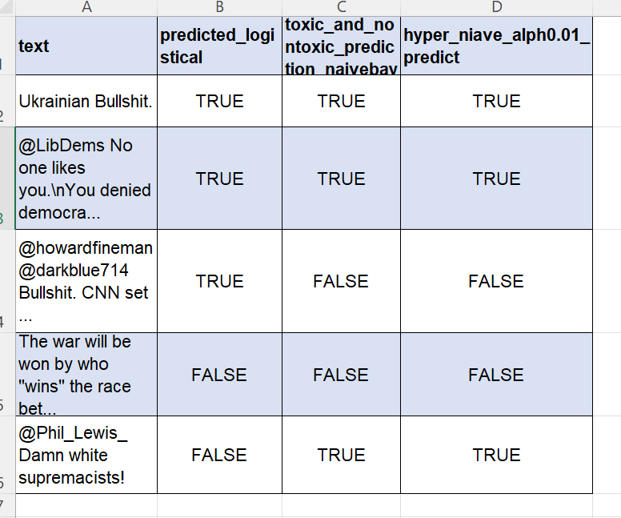

# Toxic vs Non-Toxic Comment Classification

A Python NLP project that classifies social media comments as toxic (offensive) or non-toxic using classic text-preprocessing techniques and machine learning.
Author: Ibialabo Dappa

# Overview
Social media platforms host millions of comments daily, and manually moderating abusive content does not scale. This project builds a text classification pipeline that detects offensive language in tweets, trained on a crowd-sourced offensive-language tweet dataset.

# Features
• Text cleaning and normalisation (lowercasing, removing URLs, mentions, hashtags, punctuation and stop words)
• Stemming and lemmatization
• TF-IDF feature extraction
• Class imbalance handling with SMOTE
• Model training, evaluation and comparison
• Prediction on new, unseen comments

# Dataset
• Source: Crowd-sourced offensive-language tweet dataset
• Labels: Toxic / offensive vs non-toxic
• Note: The dataset is imbalanced, so SMOTE is applied to the training split only, to avoid data leakage.
Add the dataset name, link and licence here, and place the file in the data/ folder.
Project Pipeline
1. Data loading and exploration: inspect class distribution and sample comments
2. Preprocessing: clean text, tokenise, remove stop words, then apply stemming and lemmatization
3. Feature engineering: convert text to numeric vectors with TF-IDF
4. Train/test split: stratified split to preserve class ratios
5. Balancing: apply SMOTE on the training data
6. Modelling: train classifiers (e.g. Logistic Regression, Naive Bayes, SVM)
7. Evaluation: accuracy, precision, recall, F1-score and confusion matrix
8. Prediction: classify new comments
   
# Tech Stack
• Python 3.x
• pandas, NumPy
• NLTK
• scikit-learn
• imbalanced-learn (SMOTE)
• Matplotlib / Seaborn
• Jupyter Notebook

# Installation
git clone https://github.com/<your-username>/<your-repo-name>.git
cd <your-repo-name>
pip install -r requirements.txt
Download the required NLTK resources:
import nltk
nltk.download('stopwords')
nltk.download('wordnet')
nltk.download('punkt')

# Usage
jupyter notebook text_classification.ipynb
Example prediction:
comment = "You are an amazing person"
prediction = model.predict(tfidf.transform([preprocess(comment)]))
print("Toxic" if prediction[0] == 1 else "Non-toxic")

# Results
 

# Repository Structure
├── data/                  # Dataset files
├── notebooks/             # Jupyter notebooks
├── src/                   # Preprocessing and model scripts
├── requirements.txt
└── README.md

# Limitations and Future Work

• Sarcasm, slang and code-switching (e.g. Nigerian Pidgin) can be misclassified
• Try word embeddings or transformer models such as BERT
• Extend to multi-class labels (hate speech, offensive, neutral)
• Deploy as a simple web app or API
# Contributing
Contributions are welcome. Fork the repo, create a branch and open a pull request.

# Contact
Ibialabo Dappa: Data Analyst | Data Scientist LinkedIn: add link | GitHub: add link
